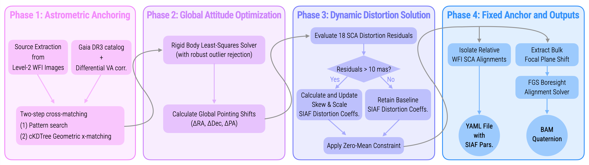

# Roman Space Telescope Pointing Calibration

This repository contains the commissioning pipeline for the Nancy Grace Roman Space Telescope's pointing calibration. It provides a modular, flight-ready toolkit to align the 18 Wide Field Instrument (WFI) Sensor Chip Assemblies (SCAs) and calibrate the Fine Guidance Sensor (FGS) boresight relative to the spacecraft body frame.

## Flowchart



## Core Capabilities

* **High-Fidelity Astrometry:** Dual-path source extraction utilizing either rapid 2D Gaussian centroiding (`photutils`) or high-precision Effective PSFs (ePSF) generated via optical models from `stpsf`.
* **Robust Cross-Matching:** Affine-based, topology-driven cross-matching algorithm utilizing full PySIAF geometric projections to securely pair sources even under massive initial pointing errors, optical parity inversions, or severe edge distortion.
* **Kinematic Transformations:** Exact spherical Differential Velocity Aberration (DVA) scaling and proper motion propagation from Gaia DR3, optimized to handle LMC zero-parallax kinematics.
* **WFI Macroscopic Alignment:** Solves the global attitude and local focal plane geometry of the 18 SCAs, preserving true physical detector plate residuals without artificial zero-mean constraints.
* **FGS Boresight Calibration:** Solves Wahba's problem using WFI cross-matched star catalogs and flight ephemeris to derive the updated Body-to-FGS quaternion (`SCF_AC_FGS_TBL_Qb`).

## Installation

This package is designed to be installed in "editable" mode, allowing you to run the extraction and alignment scripts from any data directory while maintaining a centralized codebase.

```bash
git clone https://github.com/tonysohn/roman-pointing-calibration.git
cd roman-pointing-calibration
pip install -e .
```

## Usage

The pipeline is split into four primary runner scripts located in the `scripts/` directory.

1. Batch Source Extraction

Navigate to your directory containing the Level 2 ASDF files and execute the extraction script. This will generate `.ecsv` catalogs for each SCA.

```bash
cd /path/to/commissioning/data/
python /path/to/roman-pointing-calibration/scripts/batch_extraction.py
```

2. Fetch Reference Catalog

Download the Gaia DR3 reference catalog covering the observation field. This uses the pointing telemetry embedded in your input ASDF files to frame the correct geometry

```bash
python /path/to/roman-pointing/calibration/scripts/fetch_gaia_catalog.py r0102801002001003001_0002_wfi01_f146_cal.asdf -o local_gaia_catalog.ecsv
```
3. SCA-Level Cross-Matching

Run the robust cross-matching routine to pair the extracted SCA catalogs with the downloaded Gaia reference catalog. This step bypasses gWCS divergence limits by relying purely on PySIAF modeling to handle large initial pointing errors cleanly.

```bash
python /path/to/roman-pointing-calibration/scripts/batch_crossmatch.py
```

4. Alignment & Calibration

Once the cross-matches are generated, run the master calibration solver. This executes the macro-alignment loop and calculates the boresight quaternions as well as the SIAF alignments+distortions for each SCA.

The script accepts optional command-line arguments so you can override telemetry and configuration parameters without modifying the tracked source code.

### Command-Line Arguments

### Basic Options
- `--qbj QX QY QZ QW` - Override telemetry quaternion (e.g., ST-based SCF_AC_EST_STGE_QBJ)
- `--calibrate-cgi` - Enable CGI calibration propagation and BAM export (disabled by default)
- `--sc_vel VX VY VZ` - Spacecraft Velocity (km/s) as VX VY VZ

### Configuration Options
- `--crossmatch-dir DIR` - Crossmatch input directory (default: "crossmatch_results")
- `--fit-degree N` - Alignment polynomial degree (5 for full 5th-order, 1 for affine) (default: 5)
- `--apply-dva` - Enable Differential Velocity Aberration correction (enabled by default)
- `--custom-siaf-path PATH` - Custom SIAF path to use for testing

### Example Usage

```bash
# Run with default settings
python run_calibration.py

# Run with specified crossmatch directory
python run_calibration.py --crossmatch-dir /path/to/crossmatch

# Run with spacecraft velocity overrides
python run_calibration.py --sc_vel -20 10 12

# Run with custom SIAF path and polynomial degree
python run_calibration.py --custom-siaf-path /path/to/custom_siaf.yml --fit-degree 1

# Run with all options (DVA disabled, CGI calibration enabled)
python run_calibration.py \
    --qbj 0.1 0.2 0.3 0.4 \
    --sc_vel -20 10 12 \
    --crossmatch-dir /path/to/crossmatch \
    --fit-degree 3 \
    --no-dva \
    --calibrate-cgi
```

## Outputs
* `calibrated_roman_siaf_YYYYMMDD.yml`: The updated geometric definitions for the 18 SCAs.
* `Roman_ACS_FGS_<timestampe>.txt` (and `Roman_ACS_CGI_<timestamp>.txt`): Strict ACS-compliant BAM text files containing the updated `SCF_AC_<INST>_TBL_Qb` quaternions.
* `verification_catalog.csv`: Full log of cross-matched star coordinates and focal plane residuals
* `crossmatch_results/`: Matched catalogs (.ecsv), DS9 regions (.reg), and coverage plots (.png).
* `diagnostics/`: Overlays of extracted sources, 2x2 grid quiver plots of focal plane residuals, and global attitude convergence plots.
* Standard out logging detailing the ΔRA, ΔDec, ΔPA, and the updated BAM telemetry quaternion.
